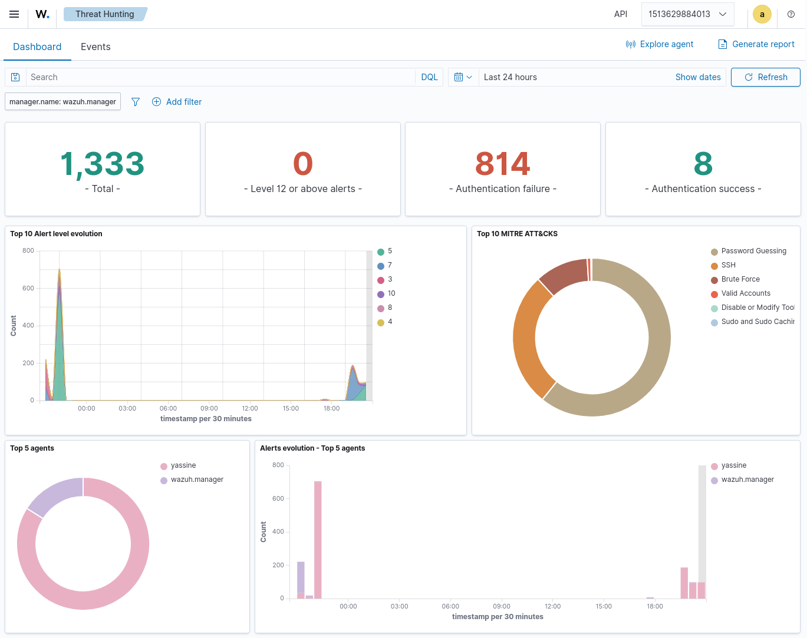
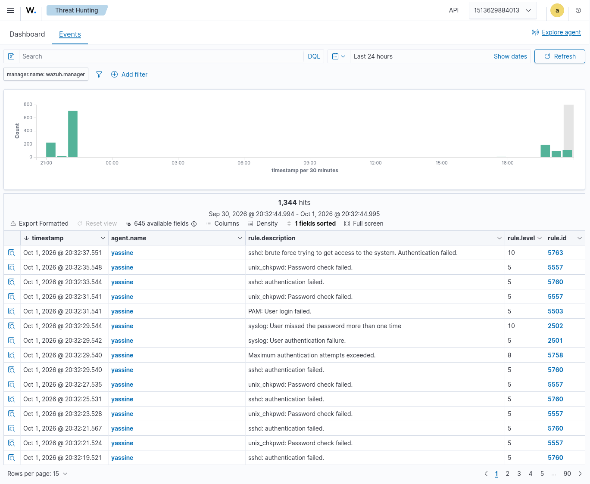
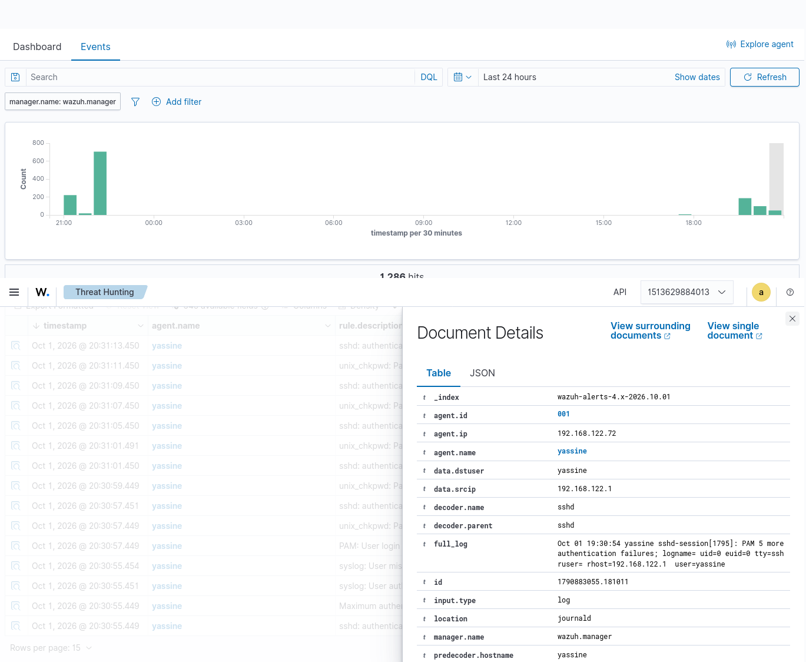
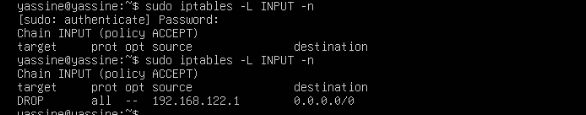
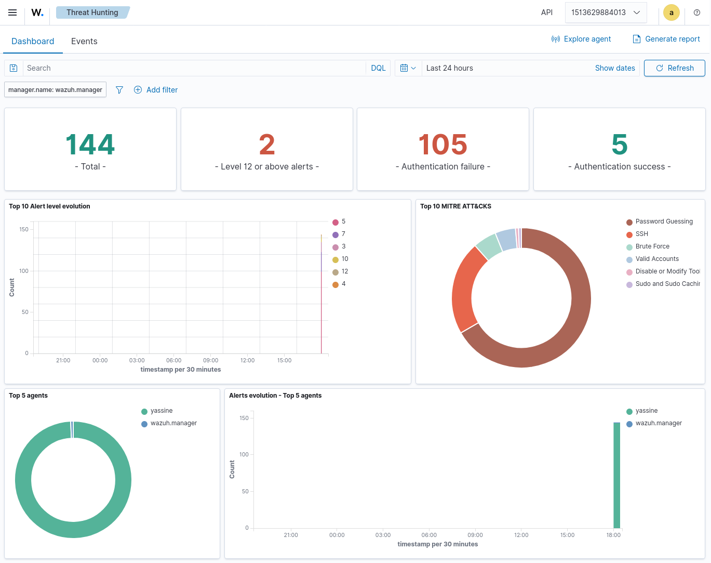
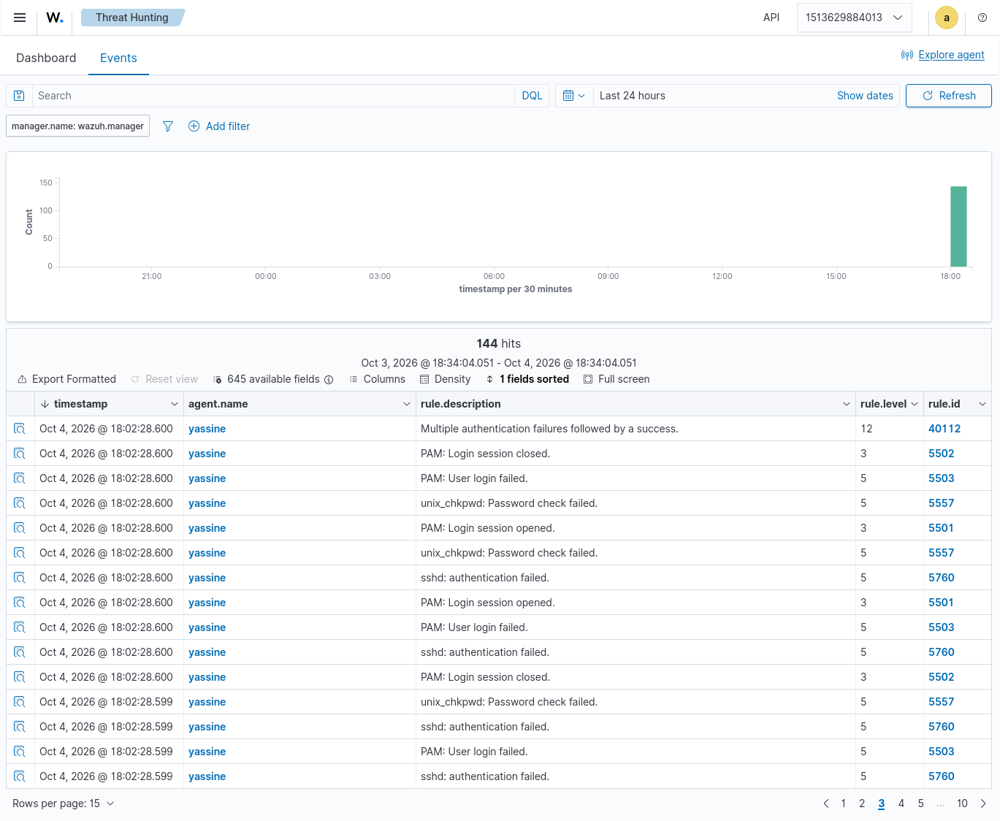
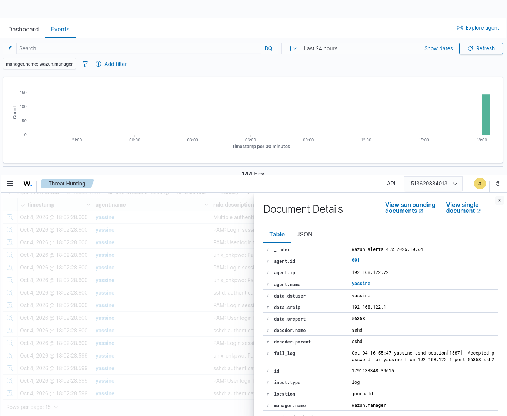

# 🛡️ SOC Analyst Project 1: SSH Brute Force Investigation & Active Response

## 📝 Executive Summary
A comprehensive investigation of a simulated SSH brute-force attack targeting a Linux server monitored by a Wazuh SIEM. This project demonstrates the complete lifecycle of a SOC incident: from initial detection (Triage) and deep log telemetry analysis (Investigation) to the automated isolation of the threat via an Active Response configuration.

## 🛠️ Environment & Tooling
* **Wazuh SIEM (v4.14.8):** Docker deployment (Manager) & Linux Agent.
* **Ubuntu Server:** Attack target (IP: `192.168.122.72`).
* **Kali Linux & Hydra:** Red team traffic generation.
* **iptables:** Target host firewall for threat containment.

## 🎯 MITRE ATT&CK Mapping
| Tactic | Technique | Sub-technique (ID) |
| :--- | :--- | :--- |
| **Credential Access** | Brute Force | Password Guessing (T1110.001) |

---

## 🔍 Investigation Phases (SOC Workflow)

### 1. Detection & Triage
The automated attack generated a massive volume of failed authentication logs. The Threat Hunting dashboard recorded over 814 authentication failures within the analyzed timeframe. 

The Wazuh correlation engine successfully detected the anomaly, triggering multiple critical Level 10 alerts:
* **Rule `5763`:** *sshd: brute force trying to get access to the system. Authentication failed.*
* **Rule `2502`:** *syslog: User missed the password more than one time.*


*> Exhibit 1: Global dashboard illustrating the spike in failed authentications and mapped MITRE ATT&CK tactics.*


*> Exhibit 2: Raw event logs and the sequence of triggered correlation rules during the attack window.*

### 2. Deep Investigation & Behavioral Analysis
Detailed inspection of the event metadata allowed for the extraction of key Indicators of Compromise (IoCs) and attacker methodology.
* **Target Asset:** Agent `yassine` (IP: `192.168.122.72`).
* **Targeted Account:** `yassine` (`data.dstuser`).
* **Threat Origin:** Source IP `192.168.122.1` (`data.srcip`).
* **Behavioral Profiling:** An analysis of the raw PAM logs (`full_log`) reveals a delta of approximately **2 milliseconds** between authentication failures. This superhuman execution velocity mechanically proves the use of an automated dictionary attack tool (e.g., Hydra) and rules out manual password guessing. 
* **Impact Assessment:** A strict DQL query filtering for successful SSH logins (`rule.id: 5715`) from the attacker's IP returned 0 occurrences. The system was not breached.


*> Exhibit 3: Document Details panel revealing the attacker's source IP, the targeted user, and the timestamp deltas.*

### 3. Automated Containment (Active Response)
To neutralize the threat in real-time without requiring human intervention, the Wazuh **Active Response** module was configured to react to critical brute-force alerts.
* **Action:** Execution of the `firewall-drop` script directly on the targeted agent.
* **Validation:** Inspection of the agent's local firewall (`iptables`) confirmed the dynamic injection of a strict `DROP` rule for the IP `192.168.122.1`, instantly severing the attacker's access.


*> Exhibit 4: Ubuntu agent console confirming the automated addition of the iptables DROP rule by the Wazuh orchestrator.*

* **Configuration Details:** The response was engineered by modifying the manager's `ossec.conf` to trigger specifically on rule `2502` with a 24-hour ban:
  ```xml
  <active-response>
    <command>firewall-drop</command>
    <location>local</location>
    <rules_id>2502</rules_id>
    <timeout>86400</timeout>
  </active-response>
  ```

### 4. Successful Compromise Simulation (Post-Containment Verification)
To validate the SIEM's advanced detection capabilities, a second attack phase was executed by modifying the `rockyou.txt` dictionary to include the user's legitimate password.
* **Behavioral Shift:** The Threat Hunting dashboard highlighted a critical evolution, recording 105 authentication failures followed by 5 authentication successes, generating two Level 12+ alerts.
* **Breach Detection:** The intrusion was instantly flagged by the critical Level 12 alert (Rule `40112`) described as "Multiple authentication failures followed by a success."
* **Forensic Evidence:** The event document details confirmed unauthorized access from the source IP `192.168.122.1` targeting the agent and user `yassine`. The raw log (`full_log`) captured the exact incoming SSH session: `Oct 04 16:55:47 yassine sshd-session[1587]: Accepted password for yassine from 192.168.122.1 port 56358 ssh2`.


*> Exhibit 4: Dashboard confirming authentication successes and critical Level 12 alerts.*


*> Exhibit 5: Event sequence showing the trigger of Rule 40112 following password discovery.*


*> Exhibit 6: Log details confirming password acceptance by the sshd daemon.*

---
## 🎫 SOC Incident Ticket
**ID:** INC-2026-001 | **Severity:** CRITICAL | **Status:** Closed (Lab Validated)

* **Date of Incident:** October 4, 2026
* **Target Asset:** Ubuntu Agent `192.168.122.72` (Targeted account: `yassine`)
* **Source (Attacker):** `192.168.122.1`
* **Vector:** `sshd` daemon (TCP Port 22)
* **Technical Analysis:** Detection of a high-velocity automated dictionary attack (MITRE T1110.001) confirmed by ~2ms intervals between requests. During the second testing phase, the attacker successfully discovered valid credentials, triggering critical rule `40112` (Multiple authentication failures followed by a success).
* **Verdict:** Successful Compromise (Simulated True Positive). Logs confirm the establishment of an unauthorized SSH session following the attack dictionary modification.
* **Remediation:** Validation of autonomous blocking via the dynamic addition of the attacker's IP address to the local firewall (`iptables`) blocklist by the Wazuh Active Response module.
## 💡 Lessons Learned & Operational Takeaways
* **The "Self-Lockout" Phenomenon:** During containment validation, the Wazuh agent successfully blocked the attacker's IP. However, because this was a lab environment where the attacker and the Wazuh Manager shared the same host IP, the agent inadvertently blocked its own manager, resulting in a "Disconnected" state. 
* **Remediation & Best Practice:** The connection was manually restored by flushing the specific `iptables` drop rule via the agent's CLI. In a production environment, this highlights the critical necessity of configuring an **IP Whitelist** (`<white_list>`) for all security infrastructure and SOC analyst subnets to prevent autonomous systems from severing their own management connections.
* **Credential Security & Defense in Depth:** The successful compromise simulation (Phase 4) demonstrated that SIEM detection must be paired with proactive hardening. The breach was possible due to weak credentials existing in a common dictionary. This highlights the necessity of enforcing strong password policies, implementing Multi-Factor Authentication (MFA), and configuring local account lockout policies (e.g., `pam_faillock.so`) to block guessing attempts at the system level before the SIEM response even triggers.